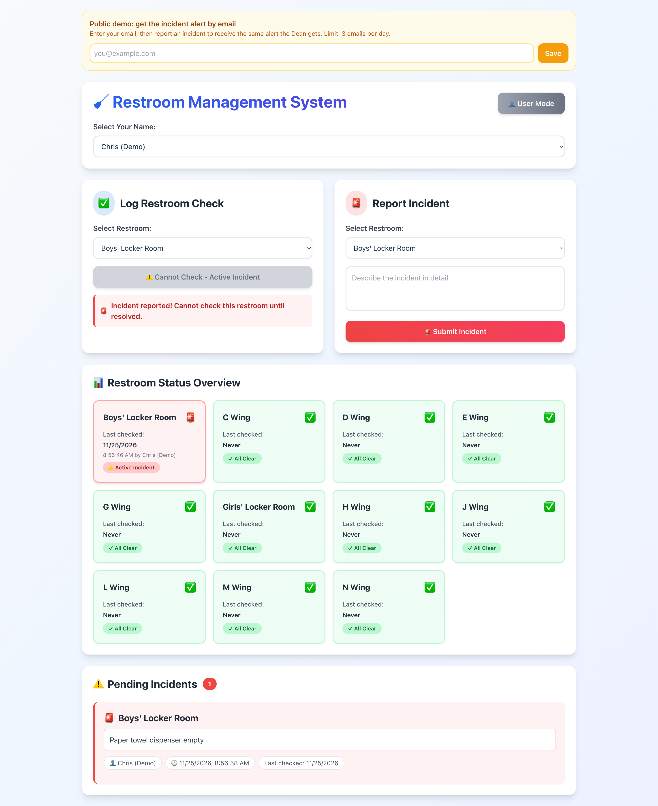

# Hygieia

**A restroom check and incident reporting app for school custodial and security staff.**

Hygieia lets staff log restroom checks with one tap and report problems like flooding, vandalism, or vaping from their phones. Administrators see every restroom's status live and get an email the moment something is reported, including when the restroom was last checked and by whom. It has been in daily use at South High School in Torrance, California, hosted on the Torrance Unified School District network.

**Try the live demo: [hygieia-demo.onrender.com](https://hygieia-demo.onrender.com)**

- Staff password: `demo-staff`
- Admin password: `demo-admin`
- Enter your email in the yellow box at the top to receive the same incident alert the Dean gets (limit 3 per day).
- The demo is a separate copy with made-up staff. It resets whenever it restarts, and it isn't connected to the school's real system.



## Why we built it

At South High, staff walked the restrooms many times a day, but nothing they saw was recorded. Problems were reported by finding an administrator in person or making a phone call. When something serious happened, nobody knew when the restroom had last been checked, so the Dean had to search hours of security footage to build a timeline.

Commercial systems use sensors or cameras, cost money, and need new hardware. Hygieia adds one tap to the walkthroughs staff already do, with no cameras, sensors, or student data.

## Features

- **One-tap restroom checks:** records who checked which restroom, with a server timestamp.
- **Incident reporting:** a restroom with an open incident can't be marked as checked until an administrator resolves it.
- **Instant email alerts:** the administrator gets the restroom, reporter, time, description, and the last check before the incident.
- **Live status overview:** every restroom's last check and open incidents, updated instantly on every device.
- **Admin mode:** only administrators can resolve incidents.
- **Assigned restrooms:** each staff member sees only the restrooms they're responsible for.
- **Monthly report:** a spreadsheet of every check and incident is emailed to the administrator on the 1st of each month.

## Tech stack

| Part              | Tools                                                              |
| ----------------- | ------------------------------------------------------------------ |
| Frontend          | React, Vite, Tailwind CSS, Axios                                   |
| Backend           | Node.js, Express                                                   |
| Database          | SQLite (better-sqlite3, WAL mode)                                  |
| Live updates      | Server-Sent Events                                                 |
| Email             | Nodemailer (school server), Google Apps Script relay (public demo) |
| School deployment | Ubuntu VM on the TUSD network, Nginx, PM2, HTTPS                   |
| Demo deployment   | Render                                                             |

## Security and privacy

- **No student data.** Hygieia stores only staff first names, restroom check times, and incident descriptions. There are no cameras or sensors.
- **Login required.** Viewing or logging anything requires the staff password. Resolving incidents requires a separate admin password, and the server checks admin status from the login session, not from the browser.
- **No secrets in the code.** Passwords, the session secret, and email credentials are stored in server settings (`.env`), which aren't committed to Git. Real staff names aren't committed either.
- **Safer by default:** database queries use parameters to prevent SQL injection, Helmet sets security headers, and text that users type is escaped before it goes into an email.
- **Public demo limits:** each visitor can only email the address they entered, with 3 emails per visitor per day and 50 per day total. The email relay rejects requests without a shared secret.
- **Known limitation:** staff currently share one password. Individual district Google sign-ins are planned.

## Run it locally

You'll need [Node.js 20](https://nodejs.org/).

```bash
git clone https://github.com/rryann0/south-hygieia.git
cd south-hygieia
npm install

cd backend
npm install
cp .env.example .env
```

In `backend/.env`, set:

- `NODE_ENV=development`
- `DB_PATH=cleanliness.db`
- `SESSION_SECRET`, `USER_PASSWORD`, and `ADMIN_PASSWORD` to values of your choice

Then start both parts:

```bash
# Terminal 1, in backend/
npm start

# Terminal 2, in the main folder
npm run dev
```

Open http://localhost:5173 and log in with your `USER_PASSWORD`. A new database starts with demo staff. Email is off unless you add the SMTP settings in `.env`.

To deploy on a server with Nginx, see [DEPLOYMENT.md](DEPLOYMENT.md) and [DOMAIN_SETUP.md](DOMAIN_SETUP.md).

## Project status

- **Nov 2025:** Built at the request of South High's Dean of Students
- **Jan 2026:** Passed TUSD EdTech's security review and deployed on the district network
- **Feb 2026:** User testing with custodial and security staff
- **2026:** In daily use at South High; submitted to the Congressional App Challenge

**Planned:** an admin dashboard for incident trends and response times, individual staff logins, maintenance and supply requests, and support for other TUSD schools.

## Acknowledgments

- Shailee Shah, who worked with me on client meetings, user testing, and documentation
- South High's Dean of Students and custodial and security staff, our clients and testers
- Our faculty advisor and the TUSD EdTech team, for mentorship, hosting, and the security review

## AI disclosure

I used Claude Code and Cursor for help with server and deployment setup and with debugging. The problem, design, and features came from our work with the people who use Hygieia, and I reviewed and tested all AI-assisted code.

## License

[MIT](LICENSE)
